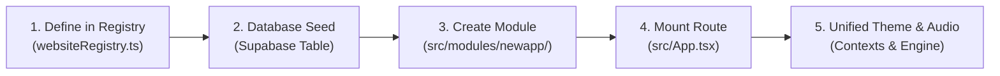

# WEBSITES — Extensibility & Future Development Guide

## 1. Architectural Philosophy

The **WEBSITES** platform is built around modularity, dynamic registry discovery, and centralized services. Adding a new website (e.g., Website #13) requires zero rewrites of existing modules and follows a standardized 5-step integration lifecycle.



---

## 2. Step-by-Step: Adding Website #13

### Step 1: Add Application to Registry
In [`src/registry/websiteRegistry.ts`](file:///C:/Users/HARISH%20VYAS/Project/Websites/src/registry/websiteRegistry.ts), append the new entry to `WEBSITE_REGISTRY`:

```typescript
{
  id: 'fintech-pulse',
  name: 'FinTech Pulse',
  tagline: 'Personal Financial Analytics & Algorithmic Portfolios',
  description: 'AI-assisted asset tracking, dividend calculators, and personal budget forecasts.',
  category: 'Business', // Or 'Lifestyle', 'Developer Tools', 'Spiritual', 'Education', 'Media'
  icon: 'TrendingUp',
  route: '/site/fintech-pulse',
  badge: 'New',
  featured: true,
  moduleName: 'FintechPulseModule',
  primaryColor: '#059669',
  tags: ['finance', 'budget', 'analytics', 'investments'],
  technologies: ['React 18', 'Tailwind CSS', 'Supabase', 'Recharts'],
  createdDate: '2026-11-01',
}
```
*The Super Main Homepage automatically discovers and renders the new website card, search indexing, and category filtering with no additional frontend layout changes.*

### Step 2: Seed into Supabase Database
In your next migration file (e.g., `007_add_fintech_pulse.sql`), insert the corresponding registry entry:

```sql
INSERT INTO public.websites (id, name, tagline, description, route_path, category, icon_name, badge, sort_order, is_featured)
VALUES (
  'fintech-pulse',
  'FinTech Pulse',
  'Personal Financial Analytics & Algorithmic Portfolios',
  'AI-assisted asset tracking, dividend calculators, and personal budget forecasts.',
  '/site/fintech-pulse',
  'Business',
  'TrendingUp',
  'New',
  130,
  true
) ON CONFLICT (id) DO NOTHING;
```

### Step 3: Implement the Isolated Module
Create directory `src/modules/fintech-pulse/` containing:
- `FintechPulseModule.tsx` (Root module wrapper)
- Internal components, hooks, and services

```typescript
import React from 'react';
import { useTheme } from '../../themes/ThemeContext';
import { unifiedAudio } from '../../services/audio/UnifiedAudioEngine';

export const FintechPulseModule: React.FC = () => {
  const { currentPalette, themeMode } = useTheme();

  return (
    <div className="p-6 max-w-7xl mx-auto space-y-6">
      <h1 className="text-2xl font-bold">FinTech Pulse</h1>
      {/* Module contents */}
    </div>
  );
};

export default FintechPulseModule;
```

### Step 4: Register Route in App Router
In [`src/App.tsx`](file:///C:/Users/HARISH%20VYAS/Project/Websites/src/App.tsx):

```typescript
const FintechPulseModule = lazy(() => import('./modules/fintech-pulse/FintechPulseModule'));

// Inside <Routes>:
<Route
  path="/site/fintech-pulse/*"
  element={
    <Suspense fallback={<ModuleLoadingFallback name="FinTech Pulse" />}>
      <FintechPulseModule />
    </Suspense>
  }
/>
```

---

## 3. High-Value Cross-Website Integrations

Future iterations can link features across existing modules:

1. **ERP Invoicing & WebBuilder:**
   - E-commerce stores designed inside WebBuilder can sync customer orders and invoices directly into the ERP General Ledger and Sales Orders.
2. **Chat & ShareIT:**
   - Couple intimates in "Just You & Me" can launch one-tap low-latency P2P screen sharing or collaborative canvas drawing using ShareIT's WebRTC engine.
3. **Doctor & CookFood:**
   - Dietary recommendations from Doctor's holistic health pillars can link directly into tagged nutritional recipes inside CookFood.
4. **MyPage & Pujas:**
   - Daily Panchang auspicious Muhurthams on Prabhata can recommend corresponding Vedic rituals and Sankalpams inside Sanatana Pujas.
5. **NCERT Study & IDE:**
   - Coding exercises within NCERT Class 11-12 Computer Science can launch directly into the Antigravity IDE Pyodide Python sandbox for instant evaluation.
