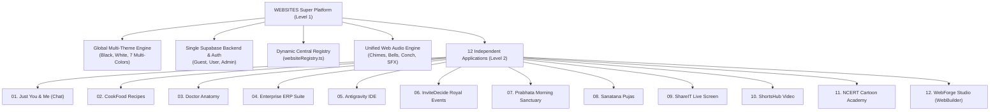

# WEBSITES — Unified Multi-Website Super Platform

[](https://github.com/sv007git/Websites/actions/workflows/deploy.yml)
[](https://sv007git.github.io/Websites/)
[](https://supabase.com)
[](https://sv007git.github.io/Websites/)

> **A production-ready, GitHub Pages-hosted platform combining 12 independent, full-featured web applications into one unified super application.**

---

## 1. Live Deployment & Repository

- **GitHub Repository:** [`https://github.com/sv007git/Websites`](https://github.com/sv007git/Websites)
- **Live Platform URL:** [`https://sv007git.github.io/Websites/`](https://sv007git.github.io/Websites/)
- **Hosting Infrastructure:** Static Single Page Application hosted on GitHub Pages with client-side SPA routing (`HashRouter` + `404.html` redirect engine).
- **Backend Infrastructure:** Single shared Supabase cloud project and unified PostgreSQL schema.

---

## 2. Platform Architecture

The platform is structured into two interconnected levels:



---

## 3. The 12 Integrated Applications

Every single feature, dataset, calculator, and audio synthesis engine from each original application is preserved without degradation:

| # | Website Name | Route | Category | Core Capabilities |
|---|---|---|---|---|
| **01** | **Just You & Me** | `/#/site/chat` | Lifestyle | Private couple intimacy space, E2EE chat, relationship prompts, cycle tracker, sync watch party, WebRTC calls. |
| **02** | **CookFood** | `/#/site/cookfood` | Lifestyle | 56 authentic Indian recipes, dynamic quantity scaling (0.5x, 1x, 2x, 4x), fraction formatting (1/2 tsp, 3/4 cup), interactive cooking timers. |
| **03** | **Doctor** | `/#/site/doctor` | Lifestyle | Vector anatomy SVG body map (25 parts), 250 condition index, 8 holistic treatment pillars, Web Speech TTS, dual-oscillator health chimes. |
| **04** | **Enterprise ERP** | `/#/site/erp` | Business | Complete React suite: CRM contacts/leads, Deals workstation with Chevron progression, Sales/Procurement, Inventory, Support tickets, HRM, General Ledger. |
| **05** | **Antigravity IDE** | `/#/site/ide` | Developer Tools | Touch-friendly CodeMirror 5 editor, mobile symbol bar, in-browser terminal emulator, Pyodide Python 3 compilation sandbox, live preview, AI assistant. |
| **06** | **InviteDecide** | `/#/site/invitedecide` | Business | Royal event SaaS: WhatsApp invitation generator, public token RSVP (`#/invite/:token`), catering buffer calculator, 2D table seating, gate QR check-in. |
| **07** | **Prabhata** | `/#/site/mypage` | Spiritual | Jean Meeus celestial panchang algorithms, solar muhurtham timings, daily Vedic dharma guide, TV9 Telugu speed news ticker, contemplation sanctuary. |
| **08** | **Sanatana Pujas** | `/#/site/pujas` | Spiritual | 21 authentic Vedic puja rituals, Priest Mode audio recitation with text tracking, synthesized bronze temple bell and conch audio engine, Vedic Sankalpam generator. |
| **09** | **ShareIT** | `/#/site/shareit` | Business | Browser WebRTC screen sharing & presentation, collaborative telestrator pen, remote pointer coordinates, in-meeting chat, 16KB chunked file transfer. |
| **10** | **ShortsHub** | `/#/site/shortshub` | Media | Vertical 9:16 Shorts player for Tamil, English, and Telugu, 4 strict curated categories, daily Dexie IndexedDB watchlist, SnapTube batch link exporter. |
| **11** | **Cartoon Academy** | `/#/site/study` | Education | Class 1-12 NCERT curriculum chapters, Sunday comic strip educational stories, 6 interactive physics/math simulations, character English TTS narration. |
| **12** | **WebForge Studio** | `/#/site/webbuilder` | Developer Tools | Visual drag-and-drop workspace canvas, 55 block registry across 8 categories, 12 production templates, relational RLS schema designer, Next.js/PHP/static code generator & ZIP exporter. |

---

## 4. Universal Multi-Theme Engine

Inspired by the couple intimacy theme architecture in "Chat, You and Me", the super platform features an instant client-side theme engine with zero page reloads:

- **Black Mode (Noir):** High-contrast pure `#000000` dark theme with subtle midnight borders, designed for battery efficiency and developer focus.
- **White Mode (Canvas):** Clean `#ffffff` daylight canvas with slate typography.
- **7 Expressive Color Palettes:**
  - 🌹 **Rose Romance:** `#f43f5e`
  - 🌊 **Ocean Blue:** `#3b82f6`
  - 🔮 **Royal Purple:** `#a855f7`
  - 🌿 **Emerald Nature:** `#10b981`
  - 💠 **Cyber Teal:** `#14b8a6`
  - 🌅 **Sunset Orange:** `#f97316`
  - 🌌 **Deep Indigo:** `#6366f1`

The active palette automatically injects CSS design tokens into the DOM root (`--color-primary`, `--color-primary-hover`, `--color-accent`, `--bg-primary`, etc.).

---

## 5. Single Shared Supabase Backend

All 12 applications interact with a single Supabase project via the centralized service in [`src/services/supabase/client.ts`](file:///C:/Users/HARISH%20VYAS/Project/Websites/src/services/supabase/client.ts).

### Consolidated Migrations Manifest
- [`001_core_platform_schema.sql`](file:///C:/Users/HARISH%20VYAS/Project/Websites/supabase/migrations/001_core_platform_schema.sql): Shared profiles, preferences, website directory, activity logs, user favorites.
- [`002_chat_couple_schema.sql`](file:///C:/Users/HARISH%20VYAS/Project/Websites/supabase/migrations/002_chat_couple_schema.sql): Couple spaces, private messages, cycle tracking, watch sessions.
- [`003_erp_enterprise_schema.sql`](file:///C:/Users/HARISH%20VYAS/Project/Websites/supabase/migrations/003_erp_enterprise_schema.sql): Multi-tenant ERP companies, accounts, deals, orders, inventory, tickets, GL ledger.
- [`004_invitedecide_events_schema.sql`](file:///C:/Users/HARISH%20VYAS/Project/Websites/supabase/migrations/004_invitedecide_events_schema.sql): Royal event SaaS, RSVP tokens, catering metrics, table seating.
- [`005_auxiliary_apps_schema.sql`](file:///C:/Users/HARISH%20VYAS/Project/Websites/supabase/migrations/005_auxiliary_apps_schema.sql): ShortsHub watchlists, CookFood recipe bookmarks, Doctor health logs, WebBuilder projects, IDE workspaces.
- [`006_seed_website_registry.sql`](file:///C:/Users/HARISH%20VYAS/Project/Websites/supabase/migrations/006_seed_website_registry.sql): Seed data registering all 12 modules into the platform database.

### Offline Prototyping Mode
If Supabase credentials are not supplied in `.env`, the platform operates in Offline Prototyping Mode automatically, allowing instant evaluation of all features without requiring database setup.

---

## 6. Local Setup & Build Instructions

```bash
# Clone the repository
git clone https://github.com/sv007git/Websites.git
cd Websites

# Install all dependencies
npm install

# Start local development server
npm run dev
# Live at: http://localhost:5173/Websites/

# Build production bundle
npm run build

# Preview production build locally
npm run preview
# Live at: http://localhost:4173/Websites/
```

---

## 7. Documentation Index

- [`PROJECT_ANALYSIS.md`](file:///C:/Users/HARISH%20VYAS/Project/Websites/PROJECT_ANALYSIS.md) — Exhaustive analysis of all 12 original projects, feature requirements, tech stacks, and integration strategies.
- [`FEATURE_MAPPING.md`](file:///C:/Users/HARISH%20VYAS/Project/Websites/FEATURE_MAPPING.md) — Direct mapping of every feature from the 12 `antigravity_prompt.txt` files to its unified implementation.
- [`DATABASE_SCHEMA.md`](file:///C:/Users/HARISH%20VYAS/Project/Websites/DATABASE_SCHEMA.md) — Comprehensive schema specifications, relational diagrams, and Row-Level Security (RLS) policies.
- [`DEPLOYMENT_GUIDE.md`](file:///C:/Users/HARISH%20VYAS/Project/Websites/DEPLOYMENT_GUIDE.md) — Complete guide for GitHub Pages automated deployment via GitHub Actions.
- [`ENVIRONMENT_SETUP.md`](file:///C:/Users/HARISH%20VYAS/Project/Websites/ENVIRONMENT_SETUP.md) — Local environment configuration, environment variables, and Supabase cloud setup.
- [`FUTURE_DEVELOPMENT.md`](file:///C:/Users/HARISH%20VYAS/Project/Websites/FUTURE_DEVELOPMENT.md) — How to add a 13th website and execute cross-module feature integrations.
- [`TESTING_REPORT.md`](file:///C:/Users/HARISH%20VYAS/Project/Websites/TESTING_REPORT.md) — Comprehensive testing report and test matrices across all 12 applications.

---

## 8. License

This project is licensed under the MIT License — preserving all individual module copyrights, assets, and licenses.
