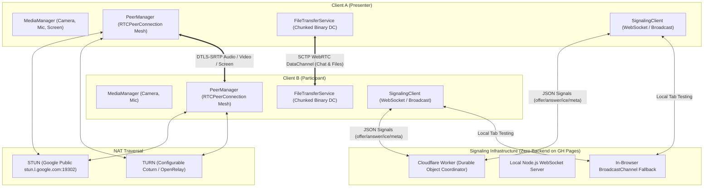

# ShareIt Architecture & Technical Specification

## 1. High-Level Architectural Overview

ShareIt is architectured as a client-side Single Page Application (SPA) deployable on static web hosting services (specifically **GitHub Pages**), separated from an external, stateless room-coordination signaling layer.



---

## 2. Media Engine & Screen Sharing Architecture

### A. Screen Sharing (`navigator.mediaDevices.getDisplayMedia`)
- Captured using modern display media API constraints:
  ```ts
  navigator.mediaDevices.getDisplayMedia({
    video: { displaySurface: 'monitor', frameRate: { ideal: 30, max: 60 }, cursor: 'always' },
    audio: true // Captures tab or system sound where supported
  });
  ```
- **Track Replacement Without Renegotiation**:
  When a user starts sharing their screen, instead of creating a brand-new peer connection and forcing full SDP renegotiation, the `PeerManager` utilizes `RTCRtpSender.replaceTrack()`:
  ```ts
  const videoSender = pc.getSenders().find(s => s.track?.kind === 'video');
  await videoSender.replaceTrack(screenVideoTrack);
  ```
  This immediately directs the screen capture stream to all remote participants with sub-100ms switching time.
- **Webcam Restoration**:
  When screen sharing ends (either from the in-app "Stop Sharing" button or the browser's native UI bar), the `ended` event listener triggers automatic track replacement back to the user's active camera track.

### B. Simultaneous Screen & Webcam
- The screen stream is rendered as the primary presentation viewport with aspect-ratio preservation (`object-contain`).
- The presenter's camera stream is rendered simultaneously in an interactive `FloatingWebcamTile`. This tile is:
  - Positioned via pointer capture for smooth 60fps drag anywhere on screen.
  - Minimizable to an unobtrusive avatar icon.
  - Expandable to view the speaker larger.

---

## 3. WebRTC Topology: Mesh vs. SFU Roadmap

### Current Production Topology: P2P Mesh
- **Connection Count**: For $N$ participants, each client maintains $N-1$ peer connections.
- **Bandwidth**: Optimal for 1-to-1 calls and small groups (up to 4–6 participants). Direct peer-to-peer latency provides the lowest possible delay (<50ms) and zero server relay costs.
- **Encryption**: End-to-end media encryption via WebRTC DTLS 1.2 and SRTP.

### Enterprise SFU Roadmap
ShareIt's `PeerManager` and `MediaManager` abstractions are explicitly separated from the UI layer. When scaling to large auditoriums or classrooms (10+ participants), the `PeerManager` can be swapped for an SFU client (such as **LiveKit** or **mediasoup**) where each participant publishes 1 stream up to the SFU and downloads composite streams down, reducing outbound client bandwidth from $O(N)$ to $O(1)$.

---

## 4. Chunked DataChannel File Transfer Protocol

To transmit files of any size without causing WebRTC buffer bloat or memory crashes, files are partitioned into 16 KB chunks:

```
[Chunk Metadata Message (JSON)]
{
  "type": "file-chunk-meta",
  "fileId": "file-123",
  "chunkIndex": 4,
  "totalChunks": 256
}

[Binary Payload (ArrayBuffer)]
<16384 bytes of raw binary data>
```

### Explicit User Verification
In compliance with strict security requirements:
1. When Sender uploads a file, a `file-offer` metadata message is emitted.
2. Receiver displays an **Accept/Reject modal** showing file name, extension, and formatted size.
3. Chunks are transmitted **only after** receiver clicks "Accept".
4. When all chunks arrive, chunks are assembled into a `Blob` and an ephemeral `URL.createObjectURL(blob)` is generated for local download.
