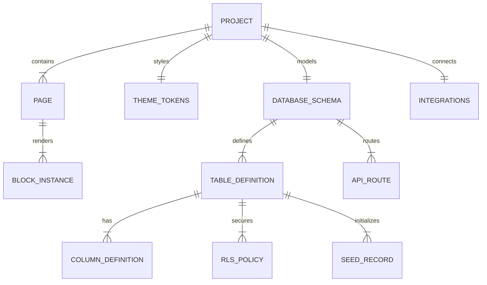

# WebForge Studio: ER Diagram & Canonical Schema Architecture

## 1. Canonical Project Model (JSON AST)

WebForge Studio uses a single, strictly-typed versioned JSON Abstract Syntax Tree (`WebForgeProjectSchema v1.0.0`) as the canonical truth across the visual editor canvas, inspector, preview engine, undo/redo history, and code generators.

### Entity Specifications

1. **`Project`**:
   * `id`: Unique identifier (UUID).
   * `name`: Human-readable project title.
   * `slug`: URL-friendly identifier.
   * `version`: Canonical AST schema version (e.g. `1.0.0`).
   * `pages`: Ordered list of `PageDefinition` instances.
   * `theme`: `ThemeTokens` object holding primary/secondary colors, fonts, spacing, border radii.
   * `database`: Relational database tables, columns, constraints, and Row Level Security policies.
   * `integrations`: GitHub, Stripe, and Email configuration.
   * `exportConfig`: Target selection (`nextjs`, `php`, `static`).

2. **`PageDefinition`**:
   * `id`: Unique page identifier.
   * `name`: Page name (e.g. "Home", "Pricing", "Admin").
   * `slug`: Web route path (e.g. `/`, `/pricing`, `/admin`).
   * `isHome`: Boolean indicating default root route.
   * `layout`: Layout wrapper (`default`, `blank`, `admin`).
   * `seo`: Page meta title, description, keywords, OpenGraph image.
   * `blocks`: Sequentially ordered `BlockInstance` objects.

3. **`BlockInstance`**:
   * `id`: Stable component UUID.
   * `type`: Registered block identifier (e.g. `navbar-classic`, `hero-split`, `admin-data-table`).
   * `name`: Custom layer display label.
   * `props`: Strongly-typed configuration values conforming to the block's schema.
   * `styles`: Custom style overrides (padding, background color, text alignment, custom CSS classes).
   * `hidden`: Visibility toggle.
   * `locked`: Prevents accidental drag or deletion.

4. **`TableDefinition` & `ColumnDefinition`**:
   * Maps directly to PostgreSQL and MySQL DDL.
   * Data types: `uuid`, `text`, `varchar`, `integer`, `decimal`, `boolean`, `date`, `timestamp`, `jsonb`.
   * Constraints: Primary key, unique, nullable, default value expressions.
   * Foreign keys: Target table, column, and cascade rules (`CASCADE`, `SET NULL`, `RESTRICT`).
   * Row Level Security: Command (`SELECT`, `INSERT`, `UPDATE`, `DELETE`, `ALL`), role (`anon`, `authenticated`, `admin`, `all`), and `USING` expression.
